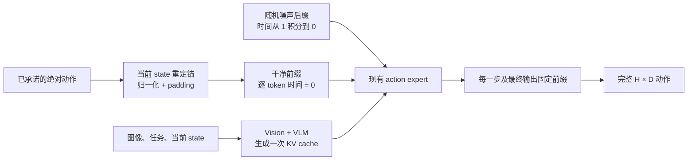
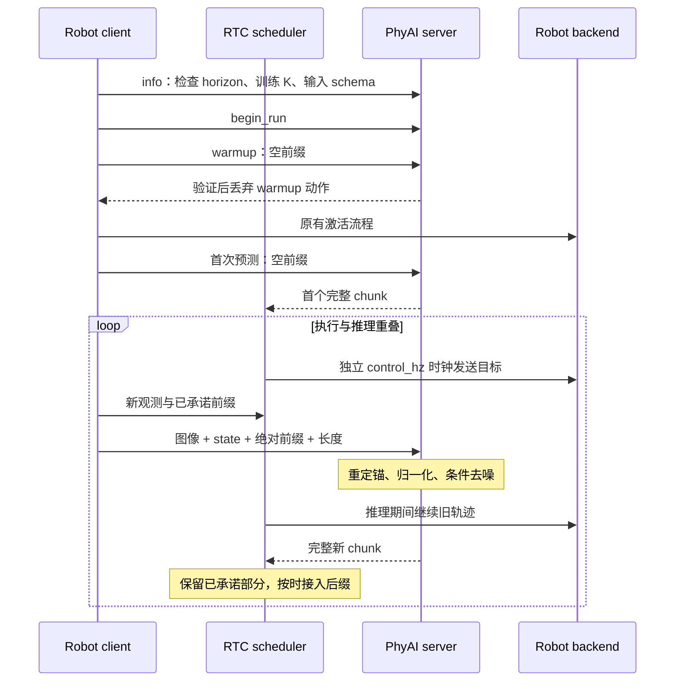

训练式 RTC 让模型在生成下一段动作时，把控制端已经承诺执行的动作当作条件。推理期间继续播放旧轨迹，结果回来后接入新后缀。它适用于使用相同动作表示、相同归一化统计，并且实际启用了前缀条件训练的 PI0.5 checkpoint。

## 从训练到部署的约定

LoongForge 的实现使用噪声时间：

```text
x(t) = t × noise + (1 − t) × action
```

训练时，对每个样本从闭区间 `[0, max_prefix_len]` 采样前缀长度。前缀输入为干净动作，时间为 `0`；后缀保留原来的 flow-matching 时间。只有后缀计入 loss。`max_prefix_len=0` 使用普通 PI0.5 路径。

推理时，前缀来自上一段已规划的轨迹。每一步 Euler 更新之前固定前缀，并为这些 token 使用 `t=0` 的 AdaRMS 调制；最后一步之后再固定一次。返回值仍是完整的 `H` 个动作。



这条路径复用已有权重、time MLP、AdaRMS、attention 和输出头。没有新增可训练参数，也不改变 checkpoint 权重的名称与 shape。PhyAI 的 AdaRMS 已支持逐行调制，因此修改集中在 PI0.5 配置、请求、scheduler 和 runner，无需修改通用算子。

`max_prefix_len` 必须从真实训练配置写入导出的 `config.json`，它记录训练能力。没有该字段的旧 checkpoint 默认值是 `0`。实际使用还需要构建时显式设置 `PI05Args(enable_rtc=True)` 或 `PI05Model(config, enable_rtc=True)`；运行开关默认关闭，关闭后走原来的普通 Pi05 路径。改大 K 或打开开关都不能替代 RTC 训练。Wall 的 loss 权重和 RLT token sidecar 是独立功能。

## 模型请求与 CUDA graph

`PI05Request` 接受可选的 `action_prefix` 和 `prefix_lengths`：

| 字段 | Shape | 含义 |
| --- | --- | --- |
| `action_prefix` | `[B, P, max_action_dim]` | 当前观测坐标系中的归一化前缀 |
| `prefix_lengths` | `[B]`，整数 | 每个样本实际使用的前缀长度；省略时全部使用 `P` |
| 模型输出 | `[B, H, max_action_dim]` | 包含已固定前缀的完整 chunk |

必须满足 `0 ≤ prefix_lengths ≤ P ≤ max_prefix_len < H`。非有限值、维度不符或单独传入长度会被拒绝。

模型 runner 为 RTC 使用固定 shape 的动作与 mask buffer。请求只更新 buffer 内容，前缀长度变化不要求重新捕获 CUDA graph。已有每层时间调制表增加一份 `t=0` 调制，去噪时根据 mask 选择。热更新权重时也重新生成这份表。

第一版只接入确定性 Euler 推理。带前缀的随机 rollout 请求会明确报错，避免把不同的轨迹概率语义混在一起。

## 绝对动作如何回到模型空间

机器人队列保存的是经过输出映射后的绝对目标。以 Tianji 为例，16 维依次为左臂 7 个关节、左夹爪、右臂 7 个关节、右夹爪。

对于 joint-delta checkpoint：

```text
new_delta[i, joint] = old_absolute_target[i, joint] − current_state[joint]
new_action[i, gripper] = old_absolute_target[i, gripper]
normalized_prefix = checkpoint_action_normalizer(new_action)
```

所有前缀 token 使用同一次新观测的 state。不能将上一轮归一化 delta 直接复制到新请求中，也不能在推理返回时重新读取 state 作为后处理锚点。

例如，旧观测关节角为 `1.0 rad`，旧模型预测 delta 为 `0.3 rad`，绝对目标就是 `1.3 rad`。新观测为 `1.1 rad` 时，这个目标在新请求中的 delta 应为 `0.2 rad`，再用同一份统计归一化。夹爪仍表示绝对目标。

前缀编码复用 checkpoint 原生 postprocessor 中的动作约定：按相反顺序撤销 delta 解码和反归一化，保留其 mask、统计、dtype 和 epsilon，最后补零至模型宽度。原生绝对动作 pipeline 没有 delta step，因此不会减 state。无法识别的自定义变换需要通过现有 processor factory 提供明确的前缀编码，程序不会猜测。

## Client 与 server



RPC 继续使用现有的 JSON 描述与 NumPy 数组消息。图像、state、前缀和结果都通过声明的 schema 验证，不传 Python 对象，也不要求机器人环境安装 Torch。模型支持 RTC 时才声明新增的固定 shape 前缀字段。

时序由 client 本地单调时钟管理；server 不需要与机器人校时。原有独占 run、warmup 丢弃、观测新鲜度检查、控制迟到上限、取消与停止清理流程继续生效。RTC 不会消除 Python 控制线程本身的 deadline jitter。

## 何时接入新后缀

设动作频率为 `f`，新观测的本地时间为 `t₀`，前缀长度为 `P`。调度器从旧轨迹采样：

```text
prefix[i] = old_trajectory(t₀ + i / f),  i = 0 ... P−1
handoff = t₀ + (P−1) / f
```

第 0 个前缀点就是拍取观测时的插值目标。这样即使观测位于两个旧动作点之间，也不需要把控制时钟重置到某个新的网格。

当结果提前返回时，调度器先保存它，旧轨迹一直执行到 `handoff`。接入新轨迹时，用原来的最后一个前缀目标作为起点，再插值到新模型的第 `P` 个动作。即使归一化往返存在浮点误差，也不会改动这个已承诺的连接点。

以 `f=25 Hz`、`P=8` 为例：

```text
观测锚点后     0       40      80     120     160     200     240     280     320 ms
已知前缀      p0------p1------p2------p3------p4------p5------p6------p7
旧轨迹        ====================================================|
新轨迹                                                            p7------a8----...
推理          [开始--------------例如 180 ms 返回]
接入时刻                                                          280 ms
```

预算是 **280 ms**，不是 320 ms，因为 8 个点之间只有 7 个间隔。预算包括前处理、RPC、模型推理、后处理和 client 的验证开销。结果必须严格早于接入时刻返回；控制线程发现到期仍无结果时，会抛出超时并走原有停止清理。传感器迟迟不能提供新观测时，旧轨迹耗尽也会停止，不会无限保持最后一个目标。

第一版采用一个在用 chunk 加一个待接入 chunk，参数需满足：

```text
2 ≤ prefix_steps ≤ execution_horizon
prefix_steps ≤ trained max_prefix_len < H
execution_horizon + prefix_steps ≤ H
```

没有自适应延迟估计或超时重试。固定预算便于验证时序；先测量部署机器的端到端推理延迟，再在训练允许的 K 范围内选择 P。扩大 P 会减少每段新生成的后缀，并推迟新观测对控制输出的影响。

## 配置 Tianji

模型目录继续保留 `config.json`、权重、tokenizer、`policy_preprocessor.json`、`policy_postprocessor.json` 和统计文件。沿用原来的 `server.yaml` 与 `serve_pi05.py` 入口。训练导出需要保留真实的 `max_prefix_len`；server 只有在 `policy.enable_rtc=true` 时才发布前缀 schema，无需新增进程或修改 ROS topic。

```yaml
# server.yaml
policy:
  enable_rtc: true
  enable_rlt: false
```

RLT 与 RTC 可以独立启用；两项默认都关闭，旧配置无需补字段即可继续使用。

下面是 **H=50、训练 K 至少为 8** 时的 client 配置示例：

```yaml
schedule:
  strategy: rtc
  action_hz: 25.0
  execution_horizon: 25
  prefix_steps: 8

control:
  control_hz: 200.0
  max_sample_age_s: 0.5
  max_control_lateness_s: 0.01
```

| 配置 | 作用 |
| --- | --- |
| checkpoint `chunk_size=50` | 每次输出 50 个动作，包括固定前缀 |
| checkpoint `max_prefix_len` | 训练过的最长前缀；0 表示未训练 RTC |
| server `policy.enable_rtc=true` | 本次构建启用 RTC；默认 false |
| `schedule.prefix_steps=8` | 锁定 8 个已承诺目标，提供 280 ms 推理预算 |
| `schedule.execution_horizon=25` | 在 RTC 模式下，每经过 25 个动作周期发起下一次预测 |
| `schedule.action_hz=25` | 源动作每 40 ms 消耗一个；应按训练时间间隔与实验播放速度选择 |
| `control.control_hz=200` | 每 5 ms 发送插值后的硬件目标 |

`execution_horizon` 在两种模式下含义有区别：`stop_and_refill` 执行前 S 个动作后暂停；RTC 每经过 S 个动作周期请求更新，已有前缀会继续执行。不要把 RTC 配置理解成“截取新 chunk 的前 25 个点重新播放”。

在机器人环境先检查配置，不连接设备：

```bash
python -m examples.deployment.tianji \
  --config /path/to/client.yaml \
  --print-config \
  schedule.strategy=rtc \
  schedule.action_hz=25 \
  schedule.execution_horizon=25 \
  schedule.prefix_steps=8
```

实际实验时，server 与 client 仍分别从各自环境运行原有入口：

```bash
# Model environment
python -m examples.deployment.serve_pi05 \
  --config /path/to/rtc-model/server.yaml \
  policy.enable_rtc=true

# Robot environment; enables control after warmup and validation
python -m examples.deployment.tianji \
  --config /path/to/client.yaml \
  schedule.strategy=rtc \
  schedule.action_hz=25 \
  schedule.execution_horizon=25 \
  schedule.prefix_steps=8
```

如果使用新 worktree 配合已有 editable 环境，先检查 `phyai`、`phyai_robot` 和 `phyai_utils_tools` 的实际 import 路径。三个包都必须指向同一个新 checkout。入口文件来自新目录，并不代表 Python 导入的库也来自新目录。

## 实现位置与验证范围

| 层 | 文件 | 负责的变化 |
| --- | --- | --- |
| 模型配置与请求 | `configuration_pi05.py`、`scheduler_pi05.py` | K 校验、前缀张量、t=0 表及热更新 |
| 模型执行 | `model_runner_pi05.py` | 固定 buffer、逐 token 调制、每一步与最终 clamp |
| 原生处理器 | `processor_pi05.py` | 反向读取动作 pipeline，编码绝对前缀 |
| Server | `examples/deployment/pi05.py` | 发布 schema、检查处理器、转发模型请求 |
| Robot adapter | `adapters.py`、`robots/tianji.py` | 将物理命令按模型顺序打包，检查能力 |
| 调度 | `scheduling.py`、`remote/client.py` | RTC 时间线、握手、截止时间与接入 |
| 快照 | `robot.py`、`deployment.py` | 同一 I/O 锁内读取观测并捕获前缀 |

CPU 验证覆盖真实 AdaRMS 的逐 token 调制公式、固定前缀的 Euler 计算、关闭 RTC 的回归、归一化与 delta 重定锚、协议字段、提前/迟到结果、重复上下文、控制插值和停止流程。模型级测试按仓库约定保存在 `.cache/`，不进入常规 CI。

这些测试不能证明真实 checkpoint 的推理质量或时延。CUDA graph replay、完整 LoongForge/PhyAI 输出对齐、端到端延迟测量和实机连续动作仍需要单独验证。本实现没有启动机器人或替换正在运行的服务。
