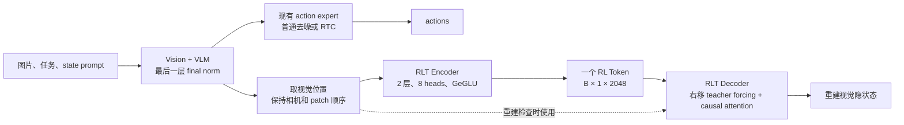

启用 RLT 的 checkpoint 会在原有动作结果之外返回一个 `rl_token`。它压缩的是最后一层 VLM 的视觉隐状态，保留语言和 state prompt 对这些状态的影响。Encoder 和 Decoder 都支持严格载入；正常动作推理只运行 Encoder。

## 计算路径



Scheduler 复用动作预测中的 VLM prefix forward，不再执行第二遍骨干。它只截取 final-normalized 视觉位置：三张 224×224 图像各产生 256 个 patch token，总共 768 个。语言位置不进入 RLT Encoder；视觉状态本身已经在 VLM 中与语言交互。

Encoder 输入是 `[visual + positions, learned_RL + fixed_last_position]`。最后的 RL 位置始终使用整张可学习位置表的最后一项，短序列也不能改用当前序列长度对应的位置。经过两层双向 attention 后，取最后一个位置作为 RL Token。没有额外 final norm 或特征归一化。

Decoder 接收 `[RL, z₀, …, zₘ₋₂]`，预测 `[z₀, …, zₘ₋₁]`。右移输入与 causal mask 同时保留，防止重建直接复制当前位置的目标。缺失视觉位置保持原来的槽位，并通过 mask 屏蔽；不能压紧后重新编号。

## 配置与输出

在转换后的 checkpoint `config.json` 中保留真实训练配置：

```json
{
  "rlt_mode": "joint",
  "rlt_max_visual_tokens": 768
}
```

`rlt_mode` 接受 `off`、`token_only` 和 `joint`。后两者描述 checkpoint 的训练模式；部署时都会正常生成动作并额外编码 RL Token。`off` 是默认值，不构建 sidecar，`engine.step(request)` 仍返回原来的动作 Tensor。

启用后，返回 `PI05Output`，支持属性访问和 named-tensor mapping：

```python
result = engine.step(request)
actions = result.actions       # [B, H, max_action_dim]
rl_token = result.rl_token     # [B, 1, text.hidden_size]
assert result["rl_token"] is rl_token
```

动作继续使用 checkpoint 原生后处理。RL Token 是表示向量，不做动作的反归一化或 delta 转换，也不发送给关节或夹爪控制接口。

`serve_pi05.py` 自动根据 checkpoint 发布额外输出 schema。现有机器人 RPC 响应包含：

| 字段 | Shape | 含义 |
| --- | --- | --- |
| `actions` | `[H, action_dim]` | 已完成原生后处理的物理目标 |
| `rl_token` | `[1, text.hidden_size]`，float32 | 去掉单请求 batch 维后的表示向量 |

Robot adapter 仍只执行 `actions`。现有专用 action gateway 保持动作协议；通用 named-tensor backend 可以读取 `PI05Output` 的两个 mapping 字段。不需要修改 ROS topic、控制频率或 RTC 调度参数。

## checkpoint 与精度

LoongForge 默认 sidecar 是 2048 维、Encoder/Decoder 各两层、8 个 heads、MLP ratio 4，包含 53 个参数 tensor，共 275,920,896 个参数。导出时需要保留完整的 `rlt_token.*` 命名空间：

- 可学习的 `rl_token`、`encoder_positions`、`decoder_positions`。
- 两套 transformer 的 LayerNorm、attention、GeGLU 权重与 bias。
- `output_projection`，以及宽度不同时存在的输入投影。

LoongForge DCP 的源键为 `model.rlt_token.*`。转换到 PhyAI safetensors 时去掉外层 `model.`，将 sidecar shard 写入模型 index，并保留上述配置。不要沿用只筛选 `model.model.*` 的骨干导出规则；它会遗漏整个 sidecar。

源 checkpoint 中的 packed QKV 顺序为 Q/K/V；MLP `mlp_in` 的顺序为 value/gate。加载器将后者重排成 PhyAI DenseMLP 的 gate/up 顺序，导出时不要再次交换。可学习位置必须从 checkpoint 读取，不能重新生成初始化值。默认 strict loading 会拒绝缺失 Decoder 或位置参数的模型。

当前 LoongForge 构造器与保存路径使用 FP32 sidecar 参数。PhyAI 也保留这个精度，独立于 Pi05 骨干的 BF16 配置。验证基准是参考实现单独调用 `encode/decode`、不套训练 autocast 的路径。训练时 BF16 autocast 的逐算子舍入和 GPU 性能需要单独评估。

完整 sidecar 的 FP32 权重约占 1.03 GiB。正常推理跳过 Decoder 计算，但 Decoder 权重仍随模型加载，供重建检查使用。

## 实现与验证

`modeling_rlt_pi05.py` 复用 PhyAI 的 LayerNorm、Linear、DenseMLP 和 Attention。带 mask 的 sidecar 使用现有 SDPA backend，避免 FlashInfer 动态压紧有效行影响固定 shape 的 graph capture。没有修改通用 layers 或 runtime。

`model_runner_rlt_pi05.py` 管理固定 batch/视觉长度的 Encoder 执行与 CUDA graph，`scheduler_pi05.py` 负责从一次 VLM 输出分出视觉状态，并返回可跨下一次请求保留的动作与 token。Decoder 的 `decode(token, features, mask)` 可单独用于离线重建检查，不在正常推理请求中执行。

CPU 测试直接载入 LoongForge 的参考模块，使用相同 safetensors 和输入，对照真实 PhyAI Encoder/Decoder 输出，并检查位置参数、权重重排、缺失 mask、NaN 屏蔽、因果隔离和 strict loading。集成测试覆盖单次 VLM 复用、旧 Tensor 返回值、RTC 同时启用、RPC 往返及自定义动作后处理。

CPU 对照采用小尺寸完整 sidecar，不代表完整 2048 维 checkpoint 已完成端到端 GPU 对齐。实机 CUDA graph replay、全尺寸延迟和训练 autocast 数值差异仍需验证。Actor、critic、reward、replay buffer 和在线学习均不属于这次实现。
